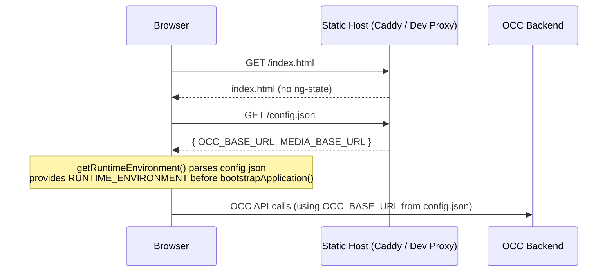
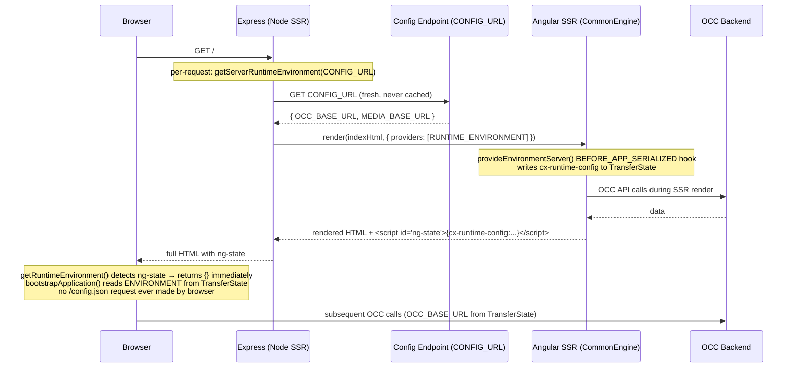
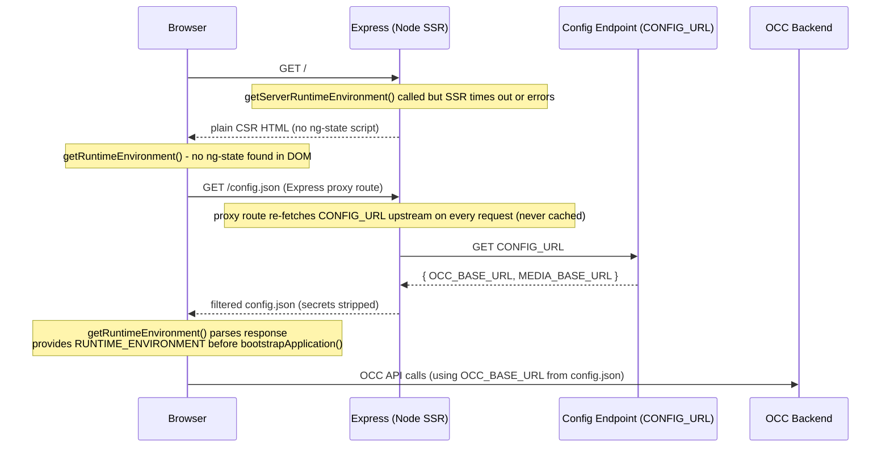

# Runtime Configuration - Request Flow Diagrams

These diagrams show how `/config.json` is fetched and consumed across the three supported
deployment topologies.

---

## CSR (browser-only, no SSR)

---

## SSR Path A - TransferState reuse (zero browser config fetch)

---

## SSR Path B - SSR timeout → browser fetches config via Express proxy

