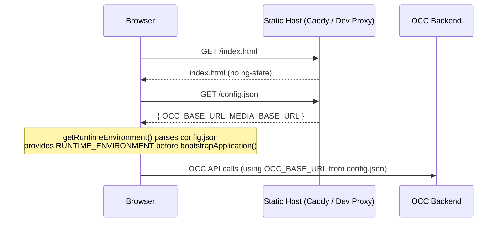
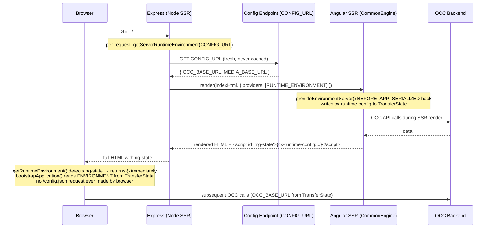
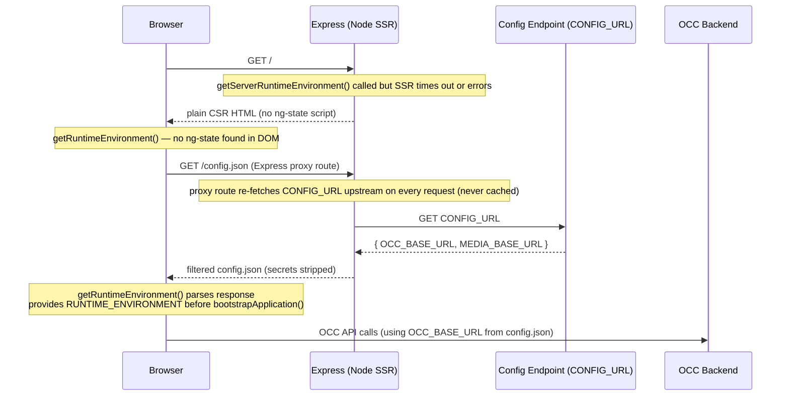

# Runtime Configuration via /config.json

## What it solves

Spartacus traditionally sets backend URLs at **build time** in two ways: either hardcoded as a literal string in `spartacus-configuration.module.ts` (the schematic default), or injected via a `<meta name="occ-backend-base-url">` placeholder that the server replaces before the page is served (`--useMetaTags`). Both require a deployment pipeline that can inject values into build artifacts — incompatible with the SAP Hosting Portal's "build once, deploy anywhere" model, and problematic for PWA deployments where rewriting built JS files breaks Service Worker file-integrity hashes.

The `/config.json` mechanism solves this by fetching environment variables from a well-known endpoint at **runtime**, before Angular bootstraps. The Hosting Portal's Caddy reverse proxy serves this file at the same origin as the storefront - no CORS, no extra infrastructure for customers. The existing `<meta>` tag mechanism remains active as a fallback.

Related ticket: [CXSPA-12541](https://jira.tools.sap/browse/CXSPA-12541). The reference implementation in the BFF project: [CXSPA-11078](https://jira.tools.sap/browse/CXSPA-11078).

---

## How it works

`/config.json` is fetched once before `bootstrapApplication()` runs (CSR) or once at Express server startup (SSR). The result is provided as the `RUNTIME_ENVIRONMENT` injection token. `provideRuntimeOccConfig()` reads this token synchronously via `provideConfigFactory` and maps the recognised keys into Spartacus `OccConfig`. The `ENVIRONMENT` token (derived from `RUNTIME_ENVIRONMENT` with SSR→CSR TransferState handoff) is the single source of truth for all config factories.

### Why the fetch is separate from the provider (`RUNTIME_ENVIRONMENT` token design)

`/config.json` is fetched **once** in `main.ts` before bootstrap and the result is stored in the `RUNTIME_ENVIRONMENT` injection token. `provideRuntimeOccConfig()` then reads that token inside a synchronous `provideConfigFactory`.

The key benefit of this split: **multiple factories can consume the same fetch result** without triggering a second network request. For example, a customer mapping a custom key alongside the built-in OCC keys:

```ts
// app.config.ts
provideRuntimeOccConfig(), // maps OCC_BASE_URL; MEDIA_BASE_URL is wired via MediaModule.forRoot()

provideConfigFactory(() => {
  const env = inject(ENVIRONMENT, { optional: true }) ?? {};
  return env['PAYMENT_API_KEY']
    ? { myPayment: { apiKey: env['PAYMENT_API_KEY'] } }
    : {};
}),
```

Both factories share the single `ENVIRONMENT` value - `/config.json` is fetched exactly once regardless of how many consumers are registered.

### Environment variable priority (lowest → highest)

```
1. DefaultConfigChunk    library defaults  (provideDefaultConfig / provideDefaultConfigFactory)
   └── MediaModule.forRoot()      ← MEDIA_BASE_URL from /config.json  (lowest — can be overridden)
        ↓
2. ConfigChunk           static app config  (provideConfig / provideConfigFactory)
   ├── <meta name="occ-backend-base-url">  ← MetaTagConfigModule (always active)
   └── provideRuntimeOccConfig()  ← OCC_BASE_URL from /config.json
```

Last write wins within the same layer. `OCC_BASE_URL` from config.json overrides meta tags because both are at `ConfigChunk` level and `provideRuntimeOccConfig()` is registered after `MetaTagConfigModule`. `MEDIA_BASE_URL` is a `DefaultConfigChunk` default — any customer `provideConfig({ backend: { media: { ... } } })` will override it. Keys absent from config.json (or set to `""`) fall through to the lower layers unchanged.

---

## config.json format

Each key maps to an object with a `value` string and an optional `secret` flag. Secret entries are stripped before being passed to Angular - they will never appear in the browser bundle or TransferState.

```json
{
  "OCC_BASE_URL": { "value": "https://api.commerce.sap.com" },
  "MEDIA_BASE_URL": { "value": "https://api.commerce.sap.com" },
  "API_KEY": { "value": "sk-abc123", "secret": true }
}
```

Keys recognised by `provideRuntimeOccConfig()` out of the box:

| Key | Maps to |
|-----|---------|
| `OCC_BASE_URL` | `backend.occ.baseUrl` |
| `MEDIA_BASE_URL` | `backend.media.baseUrl` |

Empty string values (`"value": ""`) are treated as absent - the key is skipped and the lower-priority fallback takes effect.

---

## Step-by-step setup (opt-in)

### 1. Wire the pre-bootstrap fetch (CSR) - `main.ts`

```ts
import { getRuntimeEnvironment, RUNTIME_ENVIRONMENT } from '@spartacus/setup';

getRuntimeEnvironment().then(({ runtimeEnvironment }) => {
  bootstrapApplication(AppComponent, {
    providers: [
      { provide: RUNTIME_ENVIRONMENT, useValue: runtimeEnvironment },
      ...appConfig.providers,
    ],
  });
});
```

`getRuntimeEnvironment()` fetches `/config.json` relative to `window.location.origin`. It short-circuits on CSR hydration when TransferState already contains the data written by SSR. It returns `{}` gracefully on 404 - the app boots normally without any runtime config.

### 2. Wire the SSR per-request fetch — `server.ts`

```ts
import { getServerRuntimeEnvironment, RUNTIME_ENVIRONMENT } from '@spartacus/setup';

// Inside the Express catch-all handler — called ONCE PER REQUEST, not at startup.
// This is intentional: DevOps must be able to change config.json values without
// restarting the Node server. A startup-time fetch would freeze the value and
// defeat the purpose of runtime configuration.
server.get(/.*/, async (req, res) => {
  const runtimeEnvironment = await getServerRuntimeEnvironment({
    url: process.env['CONFIG_URL'],
  });
  res.render(indexHtml, {
    req,
    providers: [
      { provide: APP_BASE_HREF, useValue: req.baseUrl },
      // IMPORTANT: per-request only — must NOT be moved to ngExpressEngine providers.
      // Angular's CommonEngine gives engine-level providers higher DI priority
      // (last-wins). Engine-level would freeze the value at startup.
      { provide: RUNTIME_ENVIRONMENT, useValue: runtimeEnvironment },
    ],
  });
});
```

`CONFIG_URL` must be an absolute URL (e.g. `http://localhost:4222/config.json`) because the Node process has no `window.location`. If `CONFIG_URL` is absent, `getServerRuntimeEnvironment` returns `{}` silently and SSR continues with build-time config.

### 3. Register the OCC config provider — `app.config.ts`

```ts
import { provideRuntimeOccConfig } from '@spartacus/setup';

export const appConfig: ApplicationConfig = {
  providers: [
    provideRuntimeOccConfig(),
    // ... rest of providers
  ],
};
```

This synchronously maps `OCC_BASE_URL` from the runtime environment into `OccConfig.backend.occ.baseUrl`. `MEDIA_BASE_URL` is mapped automatically by `MediaModule.forRoot()` in `@spartacus/storefront` — no additional call needed.

### 4. Add `provideEnvironmentServer()` to `app.config.server.ts` (SSR only)

```ts
import { provideEnvironmentServer } from '@spartacus/setup';
import { provideServerRendering } from '@angular/ssr';

const serverConfig: ApplicationConfig = {
  providers: [
    // IMPORTANT: must be first — writes cx-runtime-config to TransferState before
    // provideServerRendering's BEFORE_APP_SERIALIZED hook checks if the store is empty.
    // Moving it after provideServerRendering() silently breaks SSR config transfer.
    provideEnvironmentServer(),
    provideServerRendering(),
    importProvidersFrom(AppServerModule),
  ],
};
```

`provideEnvironmentServer()` registers a `BEFORE_APP_SERIALIZED` hook that forces `ENVIRONMENT` injection and writes the runtime config into `TransferState` as `cx-runtime-config`. This is what causes `<script id="ng-state">` to contain the config values so the browser skips fetching `/config.json` on hydration (Path A). Without it, `ng-state` is absent and the browser always fetches `/config.json` even when SSR succeeds.

**Why `BEFORE_APP_SERIALIZED` and not `APP_INITIALIZER` or a regular provider?**

`ENVIRONMENT` is wired as a lazy `useFactory` — Angular only calls the factory when something first injects it. `provideRuntimeOccConfig()` registers a `ConfigChunk` (resolved lazily when `Config` is assembled), not a `CONFIG_INITIALIZER`, so there is no guarantee `ENVIRONMENT` has been injected by the time Angular serializes TransferState.

`BEFORE_APP_SERIALIZED` fires **after rendering but before serialization** — the only hook that runs at exactly the right moment. Registering there forces the `ENVIRONMENT` factory to run, which writes `cx-runtime-config` to `TransferState`. Angular's serializer then finds the store non-empty and includes it in `<script id="ng-state">`.

**Why order matters:** `provideServerRendering()`'s own `BEFORE_APP_SERIALIZED` hook (`serializeTransferStateFactory`) checks `transferStore.isEmpty` and skips writing `ng-state` **entirely** if the store is empty at that point. `provideEnvironmentServer()` must be first so it populates the store before that check fires.

### 5. Serve `config.json` locally — Spartacus Dev Proxy

In production, Caddy serves `/config.json`. Locally you need something to do the same job. The Spartacus Dev Proxy is a small Fastify server that intercepts `GET /config.json`, reads a local file from disk, and forwards every other request to `ng serve` or `dev:ssr`. It ships in `@spartacus/setup/dev-proxy`.

**Install the proxy's runtime dependencies once:**

`fastify` and `@fastify/http-proxy` are declared as `optionalDependencies` of `@spartacus/setup`. They install automatically when you run `npm install` — no separate install step needed.

**Create `src/config.json` with empty placeholder values.** This file is read by the proxy at runtime — it is **not** a build asset and must **not** be added to `angular.json` / `project.json`:

```json
{
  "OCC_BASE_URL": { "value": "" },
  "MEDIA_BASE_URL": { "value": "" }
}
```

To avoid accidentally committing real values, add it to your personal git exclude list:

```bash
echo "src/config.json" >> .git/info/exclude
```

**CSR dev (`ng serve`):** the schematic automatically creates `proxy.conf.json` at the project root and wires it into the Angular dev server `serve` target. This means the Angular dev server (port 4200) silently forwards `GET /config.json` to the Spartacus Dev Proxy on 4222; you never need to change browser ports or know that port 4222 exists.

Run both processes in separate terminals:

```bash
# Terminal 1 — Angular dev server (browser port stays 4200)
ng serve

# Terminal 2 — Spartacus Dev Proxy (serves /config.json from src/config.json)
npx spartacus-dev-proxy
```

Open `http://localhost:4200` as usual. The `GET /config.json` request will be transparently proxied to the Spartacus Dev Proxy and return the values from your local `config.json`.

**SSR dev (`ng build` + `node dist/.../server.mjs`):** the Node process must know where to fetch config from. Set `CONFIG_URL` to the dev proxy:

```bash
# Terminal 1 — Spartacus Dev Proxy
node node_modules/@spartacus/setup/dev-proxy/run.js

# Terminal 2 — build once, then start SSR server
ng build
CONFIG_URL=http://localhost:4222/config.json \
SERVER_REQUEST_ORIGIN=http://localhost:4000 \
NODE_TLS_REJECT_UNAUTHORIZED=0 \
npm run serve:ssr:<app-name>
```

The SSR server fetches `config.json` once **per render** (not at startup) from the dev proxy. On each successful SSR render, the config is written to TransferState and the browser skips fetching `/config.json` (Path A). If SSR times out, the browser falls back to fetching `/config.json` directly via the `/config.json` proxy route in `server.ts` (Path B).

**Environment variables for local SSR dev:**

| Variable | Required locally | Purpose |
|---|---|---|
| `CONFIG_URL` | ✅ yes | Absolute URL the Node.js SSR process fetches `config.json` from. Point at the dev proxy: `http://localhost:4222/config.json` |
| `SERVER_REQUEST_ORIGIN` | ✅ yes | Tells Spartacus SSR the app origin for request context on `localhost` |
| `NODE_TLS_REJECT_UNAUTHORIZED=0` | Only with self-signed OCC cert | Bypasses TLS certificate validation. **Never use in production.** |
| `NG_ALLOWED_HOSTS` | ❌ not needed | The generated `server.ts` defaults `allowedHosts` to `['*']`. Set this only to restrict which hostnames are allowed in security-sensitive deployments. |

**Production SSR env vars (DevOps):**

| Variable | Required | Purpose |
|---|---|---|
| `CONFIG_URL` | ✅ yes | Absolute URL of the internal config endpoint (e.g. `http://internal-caddy/config.json`) |
| `PORT` | optional | Port the Express server listens on. Defaults to `4000`. |
| `SSR_ALLOWED_ORIGINS` | optional | Comma-separated origin allowlist for `getOriginValidationMiddleware`. Unset = no restriction. |

---

## Opt-out

Do not add `provideRuntimeOccConfig()` to `app.config.ts` and do not modify `main.ts` or `server.ts`. Nothing changes - no `/config.json` fetch occurs, the app behaves exactly as it does today. There is no feature flag to set and no env var to configure.

---

## Extending with custom keys

`provideRuntimeOccConfig()` maps only `OCC_BASE_URL`. `MediaModule.forRoot()` maps `MEDIA_BASE_URL`. To map additional keys from config.json to arbitrary Spartacus config, inject `ENVIRONMENT` directly and provide your own `provideConfigFactory`:

```ts
import { inject, Provider } from '@angular/core';
import { provideConfigFactory } from '@spartacus/core';
import { ENVIRONMENT } from '@spartacus/setup';

export function provideMyCustomRuntimeConfig(): Provider[] {
  return [
    provideConfigFactory(() => {
      const env = inject(ENVIRONMENT, { optional: true }) ?? {};
      return env['PAYMENT_API_KEY']
        ? { myPayment: { apiKey: env['PAYMENT_API_KEY'] } }
        : {};
    }),
  ];
}
```

Add this provider alongside `provideRuntimeOccConfig()` in `app.config.ts`. The `ENVIRONMENT` token is already resolved (with SSR→CSR TransferState handoff) by `provideRuntimeOccConfig()` — no duplicate fetch occurs.

---

## Production deployment

When Spartacus is built and deployed via the SAP Hosting Portal, Caddy acts as the reverse proxy in front of the Angular app. Caddy is responsible for **replacing the committed placeholder `config.json`** with the actual environment-specific values at deploy time.

### What the infra team must configure

1. **Serve `/config.json` at the storefront origin** - Caddy must respond to `GET /config.json` with a JSON body in the correct format:

   ```json
   {
     "OCC_BASE_URL": { "value": "https://api-<env>.commerce.sap.com" },
     "MEDIA_BASE_URL": { "value": "https://api-<env>.commerce.sap.com/medias" }
   }
   ```

2. **Set `Cache-Control: no-store`** on `/config.json` responses. This ensures infra changes (URL rotations, key updates) are picked up on the very next page load with no delay. The file is ~200 bytes served from the same origin - caching it provides no meaningful performance benefit and risks serving stale URLs after a reconfiguration.

3. **For SSR deployments** — set the `CONFIG_URL` environment variable on the Node/Express server process to the absolute URL of the config endpoint (e.g. `http://internal-caddy/config.json`). The Node process fetches this **on every SSR render**, not once at startup — this is by design so that config changes take effect on the next request without a server restart.

### Service Worker / PWA - critical

If the storefront runs as a PWA with a Service Worker, the SW cache is **separate from the HTTP cache** and will ignore `Cache-Control: no-store`. Without explicit exclusion, the SW may serve a months-old `config.json` from its cache after an infra reconfiguration.

Add `/config.json` to the `networkOnly` strategy in `ngsw-config.json`:

```json
{
  "dataGroups": [{
    "name": "config-json",
    "urls": ["/config.json"],
    "cacheConfig": {
      "strategy": "freshness",
      "maxAge": "0u",
      "timeout": "5s"
    }
  }]
}
```

Or in Workbox:

```ts
registerRoute('/config.json', new NetworkOnly());
```

---

## Request Flow Diagrams

### CSR (browser-only, no SSR)



### SSR Path A — TransferState reuse (zero browser config fetch)



### SSR Path B — SSR timeout → browser fetches config via Express proxy



---

## Troubleshooting

All log messages from the `/config.json` mechanism are prefixed with `[getRuntimeEnvironment]`, `[getServerRuntimeEnvironment]`, or `[provideRuntimeOccConfig]` for easy filtering.

### CSR: check the browser console and Network tab

**Symptom:** App boots but OCC calls fail or use the wrong base URL.

1. Open DevTools → **Network** tab and reload. Look for `GET /config.json`:
   - **404** - the dev proxy is not running or not reachable. Start `npx spartacus-dev-proxy` and verify that `proxy.conf.json` is present and the `serve` target in `angular.json` has `proxyConfig` set (the schematic wires this automatically).
   - **200 with empty values** - the file is served but values are empty placeholders. Fill in the real URLs in `src/config.json` (local dev) or ensure Caddy has replaced the placeholders (production).
   - **No request at all** - `getRuntimeEnvironment()` was not called in `main.ts`, or TransferState was already available (SSR hydration path - check the `<script id="ng-state">` element in the page source).

2. Open DevTools → **Console** tab. Filter for `provideRuntimeOccConfig`:
   - Enable **Verbose** level to see `debug` logs. `[provideRuntimeOccConfig] resolved backend config:` prints the final `backend` config object after runtime env is applied.
   - A `warn` log means the fetch failed and the app fell back to `{}` - the warning includes the HTTP status or error details.

### SSR: check the Node process stdout

**Symptom:** SSR renders with the wrong backend URL, or `/config.json` is still fetched by the browser even after a successful SSR render.

1. Check stdout for `[getServerRuntimeEnvironment]` lines on each request:
   - `Successfully loaded runtime environment from <url>` — fetch succeeded per render. If URLs are still wrong, check the content of the response body at that URL.
   - `CONFIG_URL is not set` — the env var is missing. Check the process environment: `echo $CONFIG_URL` in the server shell.
   - `Failed to fetch ... 404` / `Could not fetch` — the URL is wrong or the config server is unreachable. Verify the URL is absolute and reachable from the Node process.

2. Check for `ng-state` in the SSR HTML:
   ```bash
   curl -s http://localhost:4000/ | grep -c "ng-state"
   # 1 = SSR succeeded and config was written to TransferState (browser won't fetch /config.json)
   # 0 = SSR fell back to CSR — check server logs for timeout or error
   ```

3. Inspect what's in `cx-runtime-config`:
   ```bash
   curl -s http://localhost:4000/ | python3 -c "
   import sys, re, json
   m = re.search(r'id=\"ng-state\"[^>]*>(.*?)</script>', sys.stdin.read(), re.S)
   print(json.loads(m.group(1)).get('cx-runtime-config', 'NOT FOUND')) if m else print('ng-state absent')
   "
   ```

4. `CONFIG_URL` must be an **absolute URL** — e.g. `http://localhost:4222/config.json` or `http://internal-caddy/config.json`. A relative path like `/config.json` will fail in Node because there is no `window.location` to resolve against.

### Common misconfiguration checklist

| Symptom | Likely cause | Fix |
|---------|-------------|-----|
| No `/config.json` request in Network tab | `getRuntimeEnvironment()` not called in `main.ts` | Wire up `main.ts` per setup step 1 |
| `/config.json` 404 in browser | Dev proxy not running, or `proxy.conf.json` not wired | Start the dev proxy; verify `proxy.conf.json` exists and `angular.json` serve target has `proxyConfig` |
| OCC URL is build-time value, not runtime | `provideRuntimeOccConfig()` missing from `app.config.ts` | Add it per setup step 3 |
| SSR renders but browser still fetches `/config.json` | `provideEnvironmentServer()` missing or not first in `app.config.server.ts` | Add `provideEnvironmentServer()` as the first provider in `app.config.server.ts` (before `provideServerRendering()`) |
| `ng-state` absent from SSR HTML | SSR timed out or fell back to CSR | Check server logs; verify OCC backend is reachable from Node; increase SSR timeout if needed |
| SSR uses wrong URL despite `CONFIG_URL` set | `CONFIG_URL` is a relative path | Use an absolute URL |
| Config changes don't take effect after editing `config.json` | Browser cache or Service Worker | Hard-refresh (`Ctrl+Shift+R`); for SW see the PWA section below |
| PWA serves stale config after infra change | SW caching `/config.json` | Add `networkOnly` SW rule for `/config.json` |

The following primitives from `@spartacus/setup` are framework-agnostic and can be imported directly by the BFF project once it upgrades its `@spartacus/setup` peer dependency:

| Export | Purpose |
|--------|---------|
| `parseConfigJson(raw)` | Parses and validates config.json format, strips secrets |
| `getRuntimeEnvironment(options?)` | CSR fetch with TransferState short-circuit and 404 fallback |
| `getServerRuntimeEnvironment({ url })` | SSR fetch from absolute URL |
| `RUNTIME_ENVIRONMENT` | Generic `InjectionToken<Record<string, string>>` |

The BFF's own `provideEnvironment()` can be rebuilt on top of these primitives by providing `RUNTIME_ENVIRONMENT` with the result of `getRuntimeEnvironment()` and then reading the token in a BFF-specific factory - no need to copy the fetch logic.
