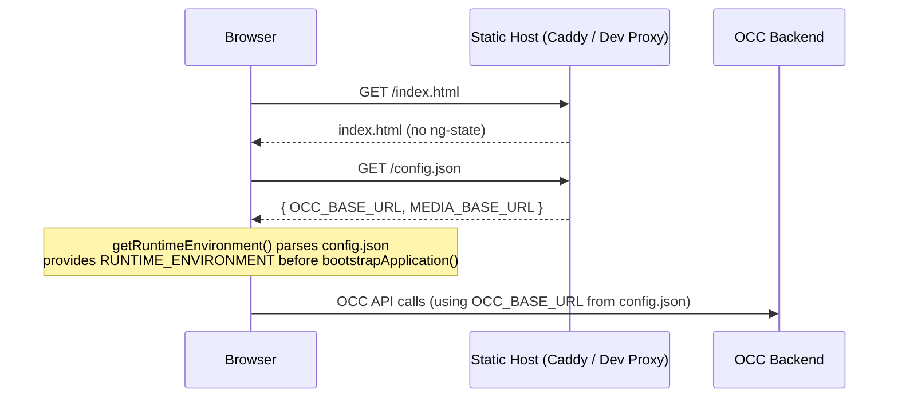
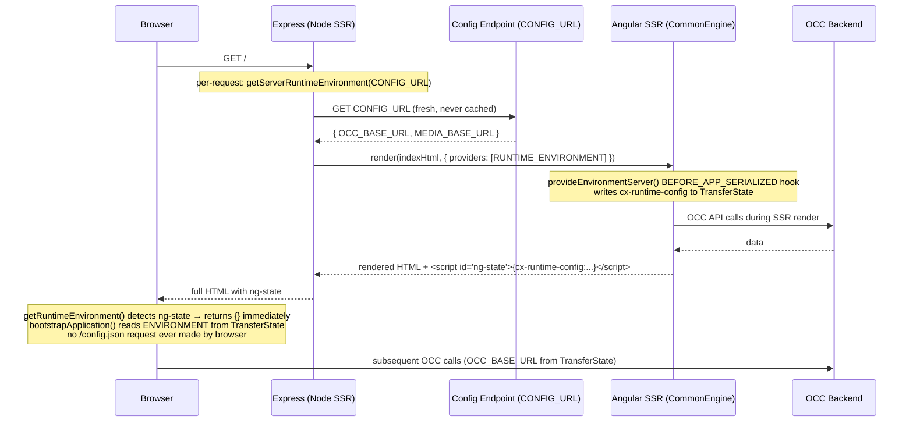
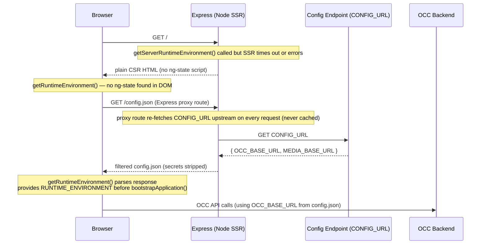

# Runtime Config via `/config.json` — `@spartacus/setup`

**Ticket:** [CXSPA-12541](https://jira.tools.sap/browse/CXSPA-12541)

---

## Overview

SAP Commerce Cloud Hosting Portal deploys container images. Without this feature, changing
the OCC backend URL (e.g. staging vs. production) requires a full frontend rebuild and
re-deploy — every environment swap needs a new build artifact.

`/config.json` runtime config lets the hosting platform inject environment-specific values
(backend URLs, etc.) at container startup by serving a small JSON file alongside the app.
The Angular app fetches it **before bootstrap**, so no rebuild is needed to change
environments.

The approach was ported from the Spartacus BFF ([CXSPA-11078](https://jira.tools.sap/browse/CXSPA-11078) / [BFF PR #1181](https://github.tools.sap/cx-commerce-storefronts/spartacus-bff/pull/1181))
with the key deviations described below.

For the Hosting Portal's specification of how Spartacus should consume configuration at runtime, see the
[BFF configuration consumption requirements](https://github.tools.sap/cx-commerce/bff-orchestrator-requirements/blob/main/features/deployment-basic-management/spartacus-ssr/configuration-consumption.md).

---

## Key Deviations from the BFF Implementation

| BFF | This port |
|-----|-----------|
| Generic `ENVIRONMENT` token (BFF-owned) | Uses `ENVIRONMENT` token from `@spartacus/core` — same token, no duplication |
| `provideEnvironment()` maps to a BFF-specific `Environment` interface | `provideRuntimeOccConfig()` maps directly to Spartacus `OccConfig` |
| `getServerRuntimeEnvironment` throws if `CONFIG_URL` is absent | Logs a warning and returns `{}` — SSR still starts, falls back to build-time config |
| TransferState key `__ENV__` | Uses `cx-runtime-config` to avoid collisions with other Spartacus state |
| Static `config.json` served by Angular DevServer | Full dev proxy (`@spartacus/setup/dev-proxy`) on port 4222 — matches production topology |
| `getServerRuntimeEnvironment` called once at server startup | Called **per SSR render** — config changes by DevOps take effect on the next request without a server restart |

---

## File Structure

```
core-libs/setup/
├── config-json/
│   ├── parse-config-json.ts                 # Parses { KEY: { value, secret } } → flat record
│   ├── parse-config-json.spec.ts
│   ├── get-runtime-environment.ts           # CSR: pre-bootstrap fetch of /config.json
│   ├── get-runtime-environment.spec.ts
│   ├── get-server-runtime-environment.ts    # SSR: fetch per render from CONFIG_URL (not at startup)
│   ├── get-server-runtime-environment.spec.ts
│   ├── provide-environment.ts               # Wires ENVIRONMENT token + TransferState handoff
│   ├── provide-environment-server.ts        # BEFORE_APP_SERIALIZED hook — forces ENVIRONMENT injection and writes cx-runtime-config to TransferState before Angular's serializer checks isEmpty (SSR only)
│   ├── provide-runtime-occ-config.ts        # Maps OCC_BASE_URL → OccConfig via CONFIG_INITIALIZER
│   ├── provide-runtime-occ-config.spec.ts
│   ├── runtime-environment.token.ts         # RUNTIME_ENVIRONMENT InjectionToken (importable standalone)
│   └── index.ts                             # Barrel
└── dev-proxy/
    ├── config-proxy-server.ts               # Fastify-based reverse proxy (startDevProxy)
    ├── defaults.ts                           # DEFAULT_DEV_PROXY_CONFIG (port 4222)
    ├── types.ts
    ├── run.ts                                # CLI entry point (spartacus-dev-proxy bin)
    └── index.ts
```

Everything is re-exported from `core-libs/setup/public_api.ts` via `export * from './config-json/index'`.

---

## `config.json` Format

The Hosting Portal serves (and the dev proxy reads) this format:

```json
{
  "OCC_BASE_URL": { "value": "https://api.commerce.sap.com" },
  "MEDIA_BASE_URL": { "value": "https://media.commerce.sap.com" },
  "API_KEY": { "value": "sk-abc123...", "secret": "true" }
}
```

- Each key is a flat string name; the value is an object with `value` (string) and optional `secret`.
- `secret: "true"` (string) and `secret: true` (boolean) are both handled — the Hosting Portal uses the string form.
- `parseConfigJson(raw, { excludeSecrets: true })` must always be used in both CSR and SSR paths so secrets never reach the browser.

**Currently mapped keys:**

| `config.json` key | Spartacus config target |
|---|---|
| `OCC_BASE_URL` | `backend.occ.baseUrl` |
| `MEDIA_BASE_URL` | wired automatically via `MediaModule.forRoot()` in `@spartacus/storefront` |

---

## CSR Bootstrap Wiring (`main.ts`)

```ts
import { getRuntimeEnvironment, RUNTIME_ENVIRONMENT } from '@spartacus/setup';

getRuntimeEnvironment().then(({ runtimeEnvironment }) => {
  bootstrapApplication(AppComponent, {
    providers: [
      { provide: RUNTIME_ENVIRONMENT, useValue: runtimeEnvironment },
      ...appConfig.providers,
    ],
  });
});
```

`getRuntimeEnvironment()` behaviour:
- Checks for `<script id="ng-state">` in the DOM first. If TransferState from SSR is present, returns `{}` immediately (config will be read from TransferState by `provideEnvironment()`).
- Otherwise fetches `/config.json` (or a custom URL via `options.url`).
- On 404 or any fetch error: logs a warning and returns `{}` — app bootstraps normally using build-time / meta-tag config as fallback.

---

## SSR Boot Wiring (`server.ts`)

The generated `server.ts` fetches `config.json` **once per SSR render** (inside the Express catch-all), not at server startup. This is the key design contract: DevOps must be able to change `config.json` values without restarting the Node server.

```ts
import { getServerRuntimeEnvironment, RUNTIME_ENVIRONMENT } from '@spartacus/setup';

// Inside the Express catch-all — called per request, not at startup.
server.get(/.*/, async (req, res) => {
  const runtimeEnvironment = await getServerRuntimeEnvironment({
    url: process.env['CONFIG_URL'],
  });
  res.render(indexHtml, {
    req,
    providers: [
      { provide: APP_BASE_HREF, useValue: req.baseUrl },
      // IMPORTANT: per-request only — must NOT be in ngExpressEngine providers.
      // Engine-level providers have higher DI priority (last-wins) and would
      // freeze the value at startup, defeating the per-request design.
      { provide: RUNTIME_ENVIRONMENT, useValue: runtimeEnvironment },
    ],
  });
});
```

`getServerRuntimeEnvironment()` behaviour:
- Called **once per SSR render**, not at server boot.
- `CONFIG_URL` must be an absolute URL. Relative URLs fail in Node (no `window.location`).
- If `CONFIG_URL` is absent: logs a warning and returns `{}` — server continues, falls back to build-time config.
- On fetch error: logs a warning and returns `{}`.
- On success: logs `[getServerRuntimeEnvironment] Successfully loaded runtime environment from <url>`.

**`ngExpressEngine` must pass `allowedHosts`:**

```ts
server.engine('html', ngExpressEngine({
  bootstrap,
  // Without allowedHosts, Angular's CommonEngine defaults to an empty set and
  // rejects all hostnames — silently falling back to CSR for every request.
  // ['*'] matches Angular's own renderApplication behaviour and is safe behind
  // a reverse proxy. Restrict via NG_ALLOWED_HOSTS in security-sensitive envs.
  allowedHosts: process.env['NG_ALLOWED_HOSTS']?.split(',') ?? ['*'],
}));
```

The schematics wire this automatically.

---

## SSR TransferState Wiring (`app.config.server.ts`)

`provideEnvironmentServer()` must be the **first** provider in `app.config.server.ts`:

```ts
import { provideEnvironmentServer } from '@spartacus/setup';
import { provideServerRendering } from '@angular/ssr';

const serverConfig: ApplicationConfig = {
  providers: [
    // IMPORTANT: must be first — writes cx-runtime-config to TransferState before
    // provideServerRendering's BEFORE_APP_SERIALIZED hook checks if the store is empty.
    // Moving it after provideServerRendering() silently breaks SSR config transfer.
    provideEnvironmentServer(),
    provideServerRendering(),
    importProvidersFrom(AppServerModule),
  ],
};
```

`provideEnvironmentServer()` registers a `BEFORE_APP_SERIALIZED` hook that forces `ENVIRONMENT` injection and writes the flat config record to `TransferState['cx-runtime-config']`. Angular's built-in serializer (from `provideServerRendering`) then includes it in `<script id="ng-state">` in the HTML response. On hydration, `getRuntimeEnvironment()` in `main.ts` detects the `ng-state` script and returns `{}` immediately — the browser never fetches `/config.json` (Path A).

**Why `BEFORE_APP_SERIALIZED` and not `APP_INITIALIZER` or a regular provider?**

`provideEnvironment()` (used internally by `provideRuntimeOccConfig()`) wires `ENVIRONMENT` as a lazy `useFactory` — Angular only calls the factory when something first injects `ENVIRONMENT`. `provideRuntimeOccConfig()` registers a `ConfigChunk`, which is resolved lazily when `Config` is assembled, not eagerly. There is no guarantee Angular will have injected `ENVIRONMENT` by the time it serializes TransferState.

`BEFORE_APP_SERIALIZED` fires **after rendering but before serialization** — it is the only Angular hook that runs at exactly the right moment: after the app has rendered (so DI is fully initialized) but before `ng-state` is written to the HTML. Registering the hook there forces the `ENVIRONMENT` factory to run, which in turn triggers `TransferState.set('cx-runtime-config', ...)`. Angular's serializer then finds the store non-empty and includes it in `<script id="ng-state">`.

**Why order matters:** `provideServerRendering`'s own `BEFORE_APP_SERIALIZED` hook (`serializeTransferStateFactory`) checks `transferStore.isEmpty` and skips writing `ng-state` entirely if the store is empty at that point. If `provideEnvironmentServer()` runs after it, the store is still empty when the check fires and `ng-state` is never written — the browser silently falls back to fetching `/config.json` on every load.

---

## Provider (`app.config.ts`)

```ts
import { provideRuntimeOccConfig } from '@spartacus/setup';

export const appConfig: ApplicationConfig = {
  providers: [
    provideRuntimeOccConfig(),
    // ...other providers
  ],
};
```

`provideRuntimeOccConfig()` does two things:
1. Calls `provideEnvironment()` which wires the `ENVIRONMENT` token with a `TransferState` read/write — SSR writes to `cx-runtime-config`, CSR reads it back on hydration.
2. Registers a `provideConfigFactory` that maps `ENVIRONMENT['OCC_BASE_URL']` → `{ backend: { occ: { baseUrl } } }` via the `CONFIG_INITIALIZER` mechanism.

---

## Opt-in / Opt-out

- **Opt-in:** add `provideRuntimeOccConfig()` to `app.config.ts` and the `getRuntimeEnvironment()` / `getServerRuntimeEnvironment()` calls to `main.ts` / `server.ts`. The schematics do this automatically.
- **Opt-out:** omit the provider entirely. Existing projects are unaffected — no feature toggle, no env var gate. Not calling the provider is a zero-cost opt-out.
- **Graceful degradation:** if `/config.json` returns 404 or is missing, the app falls back to build-time config (meta-tags, `environment.ts`). The feature never breaks an app that hasn't deployed `/config.json` yet.

---

## Schematics

Two schematics wire up the feature automatically:

| Command | Effect |
|---|---|
| `ng add @spartacus/schematics --runtime-config` | Full install including runtime config wiring |
| `ng generate @spartacus/schematics:add-runtime-config` | Adds runtime config to an existing Spartacus app |
| `ng generate @spartacus/schematics:add-runtime-config --ssr` | Also patches `server.ts` for SSR |

The schematics create:
- `config.json` at the project root (placeholder values)
- `proxy.conf.json` pointing to the dev proxy at `http://localhost:4222`
- `proxyConfig` entry in `angular.json`
- `main.ts` wrapped with `getRuntimeEnvironment()`
- `app.config.ts` with `provideRuntimeOccConfig()`
- `server.ts` patched with per-request `getServerRuntimeEnvironment()` + `RUNTIME_ENVIRONMENT` in `res.render` providers (SSR only)
- `app.config.server.ts` with `provideEnvironmentServer()` as the first provider (SSR only)

---

## Local Dev: Dev Proxy

The dev proxy (`@spartacus/setup/dev-proxy`) replicates the production Hosting Portal topology locally:

```
[Browser] → [Spartacus Dev Proxy :4222] → [Angular Dev Server :4200]
```

The proxy serves `config.json` from a local file at `/config.json` and forwards all other
requests upstream to the Angular dev server. This avoids needing to add `config.json` as
a build asset and matches what the Hosting Portal does in production.

**Start the proxy:**
```bash
npx spartacus-dev-proxy
# or via ts-node in development:
npx ts-node core-libs/setup/dev-proxy/run.ts
```

**Environment variables:**

| Variable | Default | Description |
|---|---|---|
| `SPARTACUS_DEV_PROXY_PORT` | `4222` | Port the proxy listens on |
| `SPARTACUS_DEV_PROXY_CONFIG_SOURCE_PATH` | `./config.json` | Local path to the config file |
| `SPARTACUS_DEV_PROXY_UPSTREAM_URL` | `http://localhost:4200` | Angular dev server URL |

The proxy is implemented with Fastify + `@fastify/http-proxy`. These are `optionalDependencies`
in `@spartacus/setup/package.json` and are loaded via `createRequire` at runtime so they
resolve from the consuming app's `node_modules` rather than the published package dist.

---

## Data Flow Summary

### CSR (browser-only, no SSR)

```
main.ts
  └─ getRuntimeEnvironment()         fetch /config.json relative to window.location (or {} on error)
       └─ bootstrapApplication()
            └─ provideRuntimeOccConfig()
                 └─ ENVIRONMENT token ← RUNTIME_ENVIRONMENT
                 └─ OccConfig.backend.occ.baseUrl ← ENVIRONMENT['OCC_BASE_URL']
```

### SSR Path A — TransferState reuse (zero browser config fetch)

```
Express catch-all receives request
  └─ getServerRuntimeEnvironment({ url: CONFIG_URL })  ← fetched FRESH per render
       └─ Angular SSR renders page
            └─ provideRuntimeOccConfig()
                 └─ ENVIRONMENT token ← RUNTIME_ENVIRONMENT
                 └─ provideEnvironmentServer() BEFORE_APP_SERIALIZED hook
                      └─ TransferState['cx-runtime-config'] ← ENVIRONMENT  (written during render)
                 └─ OccConfig.backend.occ.baseUrl ← ENVIRONMENT['OCC_BASE_URL']
       └─ HTML response with <script id="ng-state"> containing cx-runtime-config

browser hydration (main.ts)
  └─ getRuntimeEnvironment()  detects <script id="ng-state"> → returns {} immediately
       └─ bootstrapApplication()
            └─ provideRuntimeOccConfig()
                 └─ ENVIRONMENT token ← TransferState['cx-runtime-config']  (read from SSR)
                 └─ OccConfig.backend.occ.baseUrl ← ENVIRONMENT['OCC_BASE_URL']
                 └─ no /config.json browser request
```

### SSR Path B — SSR timeout → CSR fallback (browser fetches via Express proxy)

```
Express catch-all receives request
  └─ getServerRuntimeEnvironment()  (SSR times out or errors)
       └─ Express returns plain CSR HTML (no ng-state)

browser (main.ts)
  └─ getRuntimeEnvironment()  no ng-state in DOM → fetches /config.json
       └─ GET /config.json hits Express proxy route
            └─ Express re-fetches CONFIG_URL upstream (never cached)
            └─ returns ConfigJson format to browser
       └─ bootstrapApplication() with runtimeEnvironment from browser fetch
```

### Environment Variables

| Variable | Dev CSR | Dev SSR | Prod CSR | Prod SSR | Notes |
|---|---|---|---|---|---|
| `CONFIG_URL` | — | ✅ required | — | ✅ required | Absolute URL. Absent = `{}`, console.warn only |
| `SERVER_REQUEST_ORIGIN` | — | ✅ for localhost | — | not needed | Express infers origin from request `host` header in prod |
| `NG_ALLOWED_HOSTS` | — | not needed | — | not needed | Generated `server.ts` defaults to `['*']`; set to restrict |
| `NODE_TLS_REJECT_UNAUTHORIZED=0` | — | only for self-signed OCC cert | — | never | **Never use in production** |
| `PORT` | — | optional | — | optional | Express listen port, defaults to `4000` |

---

## Request Flow Diagrams

### CSR (browser-only, no SSR)



### SSR Path A — TransferState reuse (zero browser config fetch)



### SSR Path B — SSR timeout → browser fetches config via Express proxy



---

## End-to-End Scenario Tests

`tools/schematics/runtime-config-json-scenario-tests.ts` is a standalone script that
verifies the schematics work correctly against a real Angular CLI installation. It solves
the problem of manually re-running ~10 steps per scenario after any schematic change —
instead, a single command creates real Angular apps from scratch, runs the schematics, and
asserts both file outputs and `ng build` success.

**Three scenarios covered:**

| Scenario | What it tests |
|---|---|
| A | `ng add --runtime-config` — all wiring added (`config.json`, proxy, `main.ts`, `app.config.ts`, `server.ts` via SSR schematic) |
| B | `ng add` without `--runtime-config` — confirms zero runtime config wiring is injected |
| C | Upgrade from public npm Spartacus to a local/branch version — confirms no runtime config wiring appears as a side-effect of upgrading |

**Usage** (Verdaccio must be running — see `docs/CXSPA-12541-local-testing-guide.md`):

```bash
npx ts-node ./tools/schematics/runtime-config-json-scenario-tests.ts \
  --scenario all \
  --out-dir ~/Desktop/cx-test \
  --app-name myapp
```

Pass `--no-git` to skip per-step git commits in the generated apps (faster, no history).

---

## BFF Reuse

The three pure utility files (`parse-config-json.ts`, `get-runtime-environment.ts`,
`get-server-runtime-environment.ts`) have no BFF-specific dependencies. Once BFF upgrades
its `@spartacus/setup` peer dependency to the version that ships these utilities, it can
remove its own copies and import from `@spartacus/setup` directly.

The `RUNTIME_ENVIRONMENT` token is exported from `runtime-environment.token.ts` as a
standalone file so BFF (or any consumer) can import just the token without pulling in the
OCC mapping logic.
